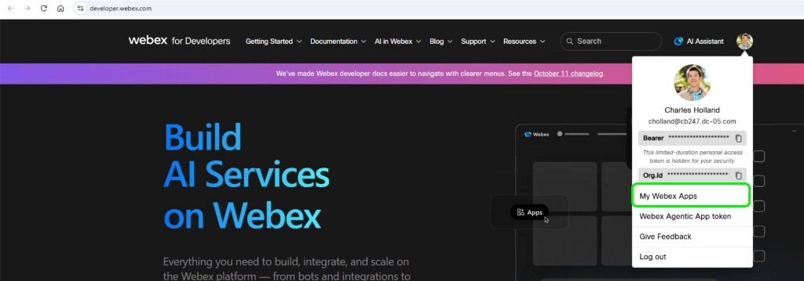
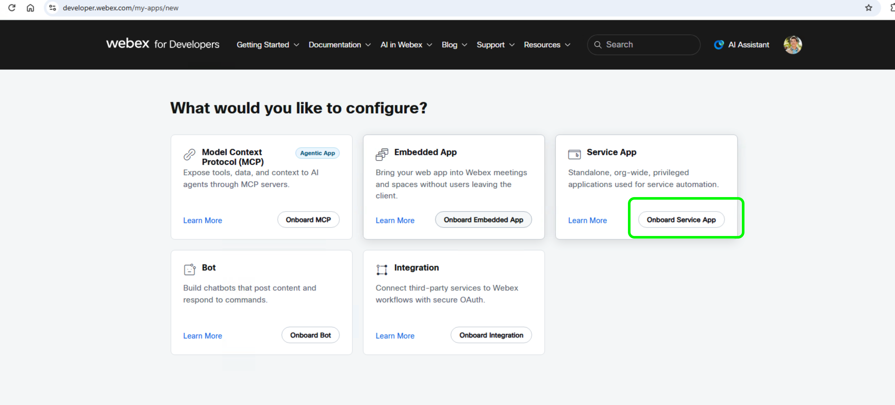
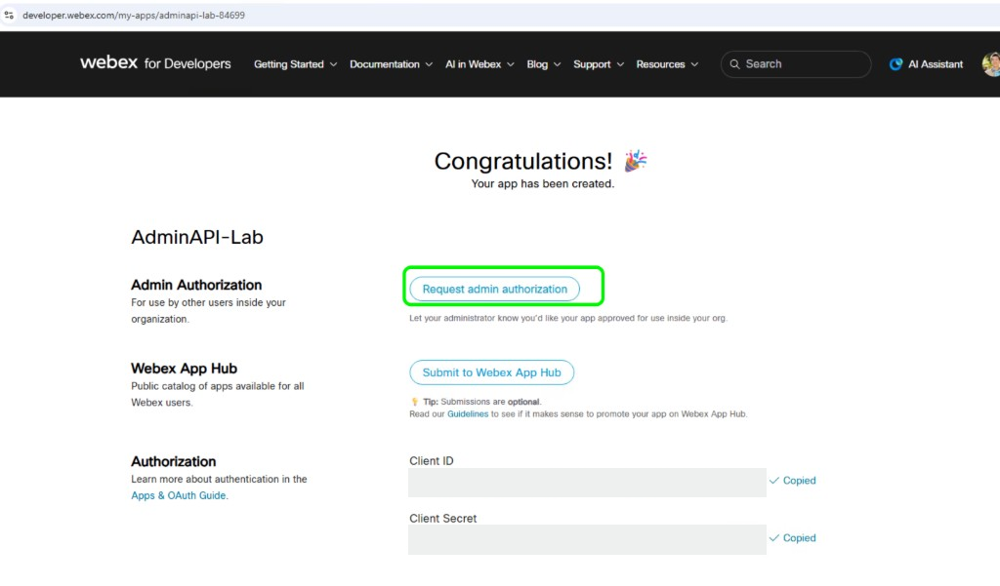
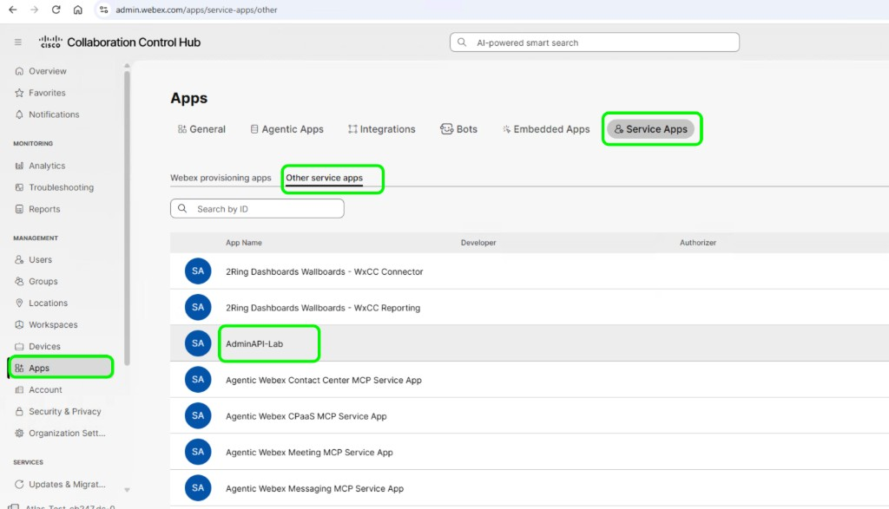
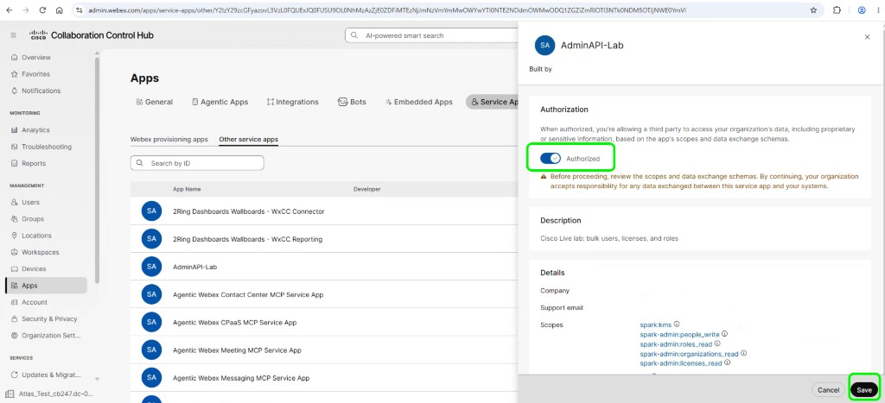

# Lab 1 - Service App, then bulk users

**Time: 12-25 min**

A personal token can create one user. Bulk create needs a Service App access token. You create the Service App once, then every section runs in **Bruno first** and **VS Code second**.

## Section 1 - Create the Service App

You play two roles here: the developer who creates the app, and the full administrator who approves it. The lab administrator account is both.

### Step 1 - Register the app

1. Open [developer.webex.com](https://developer.webex.com){:target="_blank"} and confirm you are signed in as <copy><w class="WbxUser">your lab admin</w></copy>. Use the same browser session as Lab 0.
2. Select your avatar at the top right, then select **My Webex Apps**.

    

3. The lab administrator has no apps yet, so the **What would you like to configure?** page opens. Find the **Service App** card and select **Onboard Service App**.

    

4. Fill in the form:
    * **App name**: <copy>`AdminAPI-Lab`</copy>. You search for this name in Control Hub in Step 3.
    * **Icon**: select any of the default icons
    * **Description**: <copy>`Cisco Live lab: bulk users, licenses, and roles`</copy>
    * **Contact email**: <copy><w class="WbxUser">your lab admin</w></copy>
5. Under **Scopes**, tick these six boxes and nothing else:
    * <copy>`spark-admin:people_write`</copy>
    * <copy>`spark-admin:people_read`</copy>
    * <copy>`spark-admin:licenses_read`</copy>
    * <copy>`spark-admin:roles_read`</copy>
    * <copy>`spark-admin:organizations_read`</copy>
    * <copy>`identity:people_rw`</copy>
6. Scroll to the bottom and select **Add Service App**.

### Step 2 - Save the client secret

The next page shows the **Client ID** and the **Client Secret**.

1. Copy the **Client Secret** and paste it into a new Notepad window. Do not save that Notepad file.

!!! warning "The client secret is shown once"
    You need it in Step 4 to generate tokens. If you lose it, select **Regenerate** next to **Client Secret** on the app page and copy the new value. The client secret never goes in Bruno or in `.env`.

### Step 3 - Authorize the app in Control Hub

1. On the same app page, select **Request Admin Authorization**. This makes the app visible in your organization's Control Hub.

    

2. In a new browser tab, open [admin.webex.com](https://admin.webex.com){:target="_blank"} and sign in as <copy><w class="WbxUser">your lab admin</w></copy>.
3. In the left menu, under **Management**, select **Apps**.
4. Select the **Service Apps** tab.
5. Scroll to **Other service apps**. New apps that are waiting for approval are listed there, not under the apps already authorized.
6. Find **AdminAPI-Lab** and select it. Type the name in the search box if the list is long.

    

7. In the panel that opens, check that the scopes match the six you ticked. Webex also lists `spark:kms`, which it adds to every app.
8. Turn on the **Authorized** toggle, then select **Save** at the bottom of the panel. The app now shows as authorized.

    


### Step 4 - Generate the access token

1. Go back to the developer.webex.com tab and **refresh the app page**.
2. Scroll down to **Org Authorizations**.
3. In the organization list, select your lab organization. It is the only organization listed.
4. Paste the client secret from Notepad into the **Client Secret** field.
5. Select **Generate tokens**.
6. Two tokens appear: **access_token** and **refresh_token**. Select the copy icon next to **access_token**, not refresh_token. The access token lasts about 14 days.

Leave the refresh token on that page. It does not go in Bruno or in `.env`. You can close the Notepad window with the client secret without saving it.

## Section 2 - Put the Service App token in Bruno and VS Code

### What you are doing in this section

You replace the personal access token from Lab 0 with the Service App access token: in Bruno as the `access_token` secret, and in VS Code as a `.env` file. Keep the developer.webex.com tab with the token open until you finish.

### Part A - Bruno

**Replace the token**

1. Switch to **Bruno**.
2. Open the environment list at the top right of the window and select **Configure**. The **Environments** tab opens, with **Lab** selected in the left list.
3. Select the **Secrets** tab.
4. In the `access_token` row, select the **Value** field and delete the personal access token from Lab 0.
5. Paste the Service App access token into **Value**, then select **Save**.

You do not change any other variable. `test_domain` and `org_id` stay as you set them in Lab 0.

**Check that Bruno now acts as the Service App**

1. In the Bruno left sidebar, expand **Webex Admin API Lab**, then expand **0. Setup**, and select **Who am I (/people/me)**.
2. Select the arrow (**Send**) at the right end of the URL bar.
3. In the response pane, check that **displayName** is now **AdminAPI-Lab**, the Service App.
4. In the same **0. Setup** folder, select **List organizations** and select **Send**.
5. In the response pane, confirm the list shows your lab organization.

The `id` in this response has a different format from the Control Hub Organization ID. That is expected; keep `org_id` as you set it in Lab 0.

### Part B - VS Code

The scripts read the token from a file named `.env` in the `admin-api` folder.

**Create the `.env` file**

1. On the lab desktop, open **File Explorer** and go to **Desktop → admin-api**.
2. Right-click `env-template.txt` and select **Open with → Notepad**. The file looks like this:

    ```text
    WEBEX_ACCESS_TOKEN=

    WEBEX_API_BASE=https://webexapis.com/v1
    WEBEX_SCIM_BASE=https://webexapis.com/identity/scim
    ```

3. Select the end of the `WEBEX_ACCESS_TOKEN=` line and paste the Service App access token directly after the `=`. Keep it on one line, with no spaces and no quotes. Do not change the other lines.

    You add only the token. The scripts read the organization ID from the token, so `.env` has no organization ID line.

4. In Notepad, select **File → Save As**, and set these fields:
    * **Folder**: `Desktop\admin-api`, the same folder as the template
    * **File name**: `.env`
    * **Save as type**: **All Files (\*.\*)**. If you leave **Text Documents**, Notepad saves `.env.txt` and the scripts cannot find it.
    * **Encoding**: **UTF-8**. Do not choose **Unicode**.
5. Select **Save**, then close Notepad. `Desktop\admin-api` now has a file named `.env` next to `env-template.txt`.

!!! warning "Treat `.env` like a password"
    `.env` now contains a live access token. Do not open it during a screen share, attach it, or paste it into chat.

**Open the lab folder in VS Code**

1. Open **VS Code**.
2. If the **Explorer** panel on the left already shows **ADMIN-API** at the top, the folder is open. Go to the next step. Otherwise, select **File → Open Folder**, select `Desktop\admin-api`, and select **Select Folder**. If VS Code asks whether you trust the authors of the files, select **Yes, I trust the authors**.
3. In the **Explorer** panel, confirm you can see the `scripts` and `data` folders and the `.env` file.

**Open a terminal**

All the Python commands in this lab run in the VS Code terminal.

1. In the VS Code menu bar at the top, select **Terminal → New Terminal**. You can also press `` Ctrl+` ``, the backtick key to the left of `1`.
2. A terminal panel opens at the bottom of the VS Code window. The prompt shows the current folder and ends with `Desktop\admin-api>`.
3. If the prompt shows a different folder, type the command below and press `Enter`:

    ```bat
    cd $HOME\Desktop\admin-api
    ```

To run a command from this guide, select the copy icon on the code block, right-click in the terminal to paste, and press `Enter`. Run every command in this lab from this terminal, in the `admin-api` folder. Each command starts with `scripts\.venv\Scripts\python.exe`, the Python that is already installed for this lab, so you do not need to install or select anything.

**Check that the scripts now act as the Service App**

1. In the terminal, run:

    ```bat
    scripts\.venv\Scripts\python.exe scripts\00_check_token.py
    ```

2. Check that **Name** is **AdminAPI-Lab** and your lab organization is listed. Both tools now use the Service App token.

## Section 3 - Bulk create

### What you are doing in this section

You create several users in one **SCIM 2.0 Bulk** request: `labuser02` to `labuser06` in Bruno, and the five people in `data\users.csv` with the script.

### Part A - Bruno

**Send the request**

1. In the Bruno left sidebar, under **Webex Admin API Lab**, expand the **1. Users** folder and select **Bulk create users (SCIM 2.0)**.
2. Confirm the URL bar shows `{{scim_base}}/{{org_id}}/v2/Bulk`.
3. Select the **Body** tab and confirm the JSON list is named `operations`. It creates `labuser02` to `labuser06`. `labuser01` is the user you created in Lab 0, so it is not in this list.
4. Select the arrow (**Send**) at the right end of the URL bar.

**Read the response**

There is one entry per user. `status` `201` means **Created**, and the end of `location` is the new user's id. `409` means the user already exists.

### Part B - VS Code

`data\users.csv` lists names only. The script adds your pod's domain, <copy><w class="TestDomain">your verified domain</w></copy>, so you do not edit the CSV.

**Run the bulk create**

1. In the VS Code terminal, check that the prompt ends with `Desktop\admin-api>`.
2. Copy the command below, right-click in the terminal to paste it, and press `Enter`:

    ```bat
    scripts\.venv\Scripts\python.exe scripts\01_bulk_users.py create --csv data\users.csv --mode scim
    ```

**Read the output**

Each user prints a line such as `[201] barbara.liskov@your-domain -> <id>`, and the last line is `Done. 5 users created.` The script records these users in `data\created_users.json`, so later steps update and delete only them.

## Section 4 - Update user titles in Bruno and VS Code

### What you are doing in this section

You set the title `Cisco Live Attendee` with `PUT /v1/people/{id}`: on `labuser01` in Bruno, and on the Section 3 script users in VS Code. `PUT` replaces the whole record, so each request also sends the user's email and names.

### Part A - Bruno

**Send the update**

1. Switch to **Bruno**.
2. In the left sidebar, expand **Webex Admin API Lab**, then expand **1. Users**, and select **Update user (People API)**. It opens in a new tab.
3. Look at the URL bar. It shows `PUT {{base_url}}/people/{{person_id}}`. Bruno fills `{{person_id}}` with the id of `labuser01`, which **Create user** saved in Lab 0.
4. Select the **Body** tab. The JSON contains the email address, display name, first name, last name, and `"title": "Cisco Live Attendee"`. You do not need to change anything.
5. Select the arrow (**Send**) at the right end of the URL bar.

**Read the response**

The status is **200** and `title` is now `Cisco Live Attendee`. A **404** means `person_id` is empty; run **Create user (People API)** from Lab 0 again.

### Part B - VS Code

**Open the terminal**

1. Switch to **VS Code**.
2. If the terminal panel from Section 2 is still open at the bottom of the window, select it. Otherwise, select **Terminal → New Terminal** in the menu bar, or press `` Ctrl+` ``.
3. Check that the prompt ends with `Desktop\admin-api>`. If it does not, run `cd $HOME\Desktop\admin-api`.

**Run the update**

1. Select the copy icon at the top right of the code block below to copy the command:

    ```bat
    scripts\.venv\Scripts\python.exe scripts\01_bulk_users.py update --title "Cisco Live Attendee"
    ```

2. Right-click in the terminal to paste the command, then press `Enter`. Keep the quotes around the title.

**Read the output**

The script prints one `updated <email>` line per user, then `Done.` If it prints `Nothing to update - run 'create' first.`, run the Section 3 VS Code command first.

**Check the result in Control Hub**

1. Switch to the browser tab with Control Hub at [admin.webex.com](https://admin.webex.com){:target="_blank"}.
2. In the left menu, under **Management**, select **Users**.
3. Search for one of the email addresses from the script output, and select that user to open their details.
4. Check that the title is **Cisco Live Attendee**.
5. Search for `labuser01` as well, and check that the Bruno update also set its title.

## Checkpoint

You are ready for Lab 2 when:

* [ ] **Who am I** in Bruno shows the Service App
* [ ] **List organizations** shows your lab organization
* [ ] `.env` is saved as UTF-8 with the Service App access token, and `00_check_token.py` shows **AdminAPI-Lab**
* [ ] Bulk create returned `201` in Bruno and in VS Code
* [ ] Update set the title in both tools

You delete these users at the end of the lab, in the [Conclusion](conclusion.md). Keep them for now; Lab 3 assigns a role to one of them, and Lab 4 assigns them the Hybrid Calendar license.

## Troubleshooting

| Problem | Solution |
| --- | --- |
| Service App is not listed in Control Hub | On the app page at developer.webex.com, select **Request Admin Authorization**. Then refresh **Management → Apps → Service Apps** and look under **Other service apps** for your app name. |
| **Org Authorizations** has no organization | The app is not authorized yet. Finish Step 3, then refresh the app page. |
| **Generate tokens** rejects the client secret | The secret was not copied in full. Select **Regenerate** next to **Client Secret**, copy the new value, and try again. |
| 401 | Generate tokens again. Replace the Bruno secret and `WEBEX_ACCESS_TOKEN`. Save `.env` as UTF-8 and try again. |
| Who am I still shows the administrator | Bruno still has the personal token. Paste the Service App access token into the `access_token` secret. |
| `WEBEX_ACCESS_TOKEN is not set` | `.env` is missing, saved as `.env.txt`, or saved outside `admin-api`. Save it again with **Save as type: All Files**. |
| `could not read the organization id from the token` | `.env` has the wrong token. Paste the Service App access token into `WEBEX_ACCESS_TOKEN` and save `.env`. |
| SCIM 400 on `Operations` | Rename that field to `operations`. |
| SCIM rejects the organization id | In Bruno, open the Lab environment (**Configure**) and check that `org_id` is the **Organization ID** from Control Hub (**Management → Account → Info**). Select **Save**, then send bulk create again. |
| CSV file not found | The VS Code terminal is not in `Desktop\admin-api`. |
| 409 on create | That email already exists. Use a different address in the CSV or in the Bruno body. |

Continue to [Lab 2](lab2_licenses.md).
