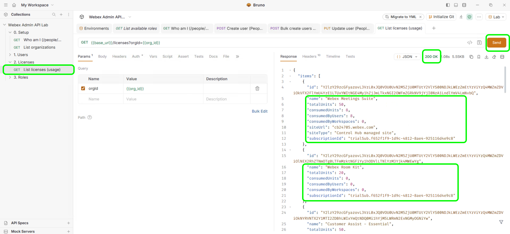
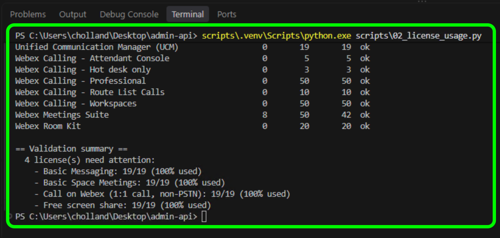
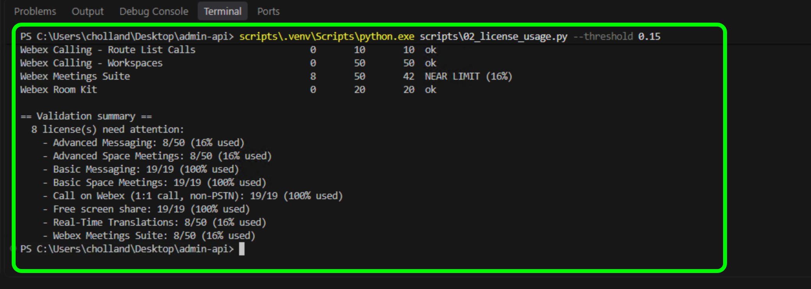

# Lab 2 - License usage

**Time: 25-32 min**

Keep the Service App access token from Lab 1. List the same licenses in Bruno first, then in VS Code.

## Section 1 - List licenses

### What you are doing in this section

You read license usage with `GET /v1/licenses`: Bruno shows the raw JSON, and the script shows it as a table.

### Part A - Bruno

**Send the request**

1. Switch to **Bruno**.
2. In the left sidebar, expand **Webex Admin API Lab**, then expand **2. Licenses**, and select **List licenses (usage)**.
3. Confirm the URL bar includes `orgId={{org_id}}`. `org_id` is the organization ID you set in the Lab environment in Lab 0.
4. Select **Send** at the right end of the URL bar.

    

**Read the response**

The status is **200 OK**. `items` has one entry per license, with `name`, `totalUnits` (units owned), and `consumedUnits` (units assigned to users).

### Part B - VS Code

**Open the terminal**

1. Switch to **VS Code**.
2. If the terminal panel from Lab 1 is still open at the bottom of the window, select it. Otherwise, select **Terminal → New Terminal** in the menu bar, or press `` Ctrl+` ``.
3. Check that the prompt ends with `Desktop\admin-api>`. If it does not, run `cd $HOME\Desktop\admin-api`.

**Run the license report**

1. Select the copy icon at the top right of the code block below to copy the command:

    ```bat
    scripts\.venv\Scripts\python.exe scripts\02_license_usage.py
    ```

2. Right-click in the terminal to paste the command, then press `Enter`.

    

**Read the output**

**Used** and **Total** match Bruno, and **Free** is Total minus Used. **Status** is `NEAR LIMIT` when a license is at least 90% used. The **Validation summary** lists those licenses, typically **4** on a lab pod.

## Section 2 - Flag licenses near their limit

### What you are doing in this section

You rerun the report with `--threshold 0.15`, which flags licenses at 15% used instead of the default 90%. Lab pods have low usage, so a low value makes the change visible; in production you would use `0.8` or `0.9`. This is VS Code only.

### Run the report with a lower threshold

1. In the VS Code terminal, copy and paste the command below, then press `Enter`:

    ```bat
    scripts\.venv\Scripts\python.exe scripts\02_license_usage.py --threshold 0.15
    ```

    

### Read the output

The numbers are the same as Section 1; only the rule changed. Licenses at 8 of 50 (16%), such as **Webex Meetings Suite**, change from `ok` to `NEAR LIMIT (16%)`, and the summary grows from **4** to **8**. If nothing changes, your pod has no licenses between 15% and 90% used.

## Checkpoint

You are ready for Lab 3 when:

* [ ] Bruno **List licenses (usage)** returned the organization license list
* [ ] VS Code printed used, total, and free for the same licenses
* [ ] The `--threshold 0.15` run flagged more licenses than the default run, or you confirmed your pod has no licenses between 15% and 90% used

## Troubleshooting

| Problem | Solution |
| --- | --- |
| 401 | Replace the Bruno secret and `WEBEX_ACCESS_TOKEN` with a new Service App access token. |
| Empty `orgId` or a 400 on the query | `org_id` is not set. In Bruno, enter the **Organization ID** from Control Hub in the Lab environment as in Lab 0, select **Save**, and send again. |
| `WEBEX_ACCESS_TOKEN is not set` | Save `.env` in `Desktop\admin-api` and run the command from that folder. |
| `No licenses returned` | The Service App is missing the `spark-admin:licenses_read` scope. Add the scope, authorize the app again in Control Hub, and generate a new access token. |
| `--threshold` run looks the same as the default run | No license is between 15% and 90% used on your pod. This is expected. |

Continue to [Lab 3](lab3_roles.md).
