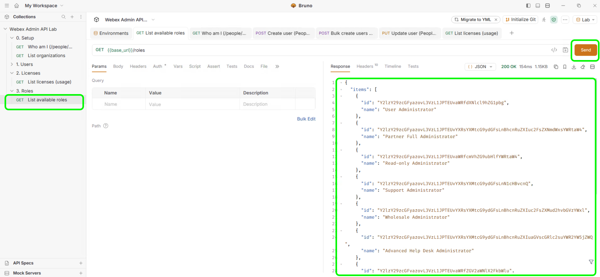
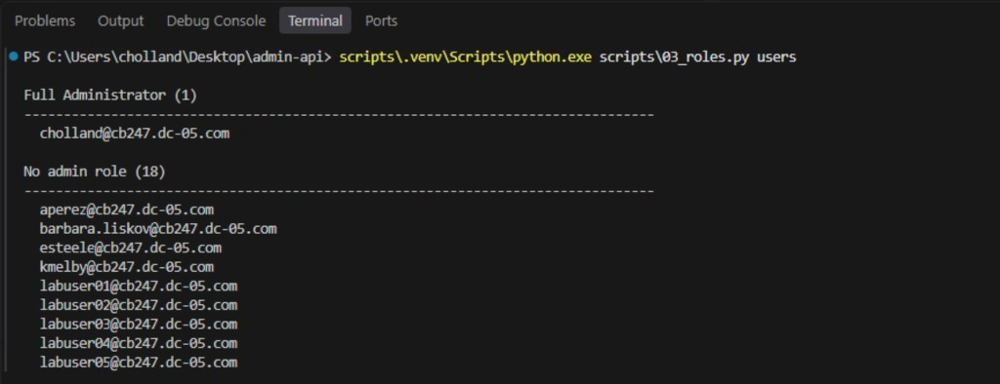

# Lab 3 - Roles

**Time: 32-40 min**

List the administrator roles in Bruno first, then list users by role in VS Code. Assigning a role runs in VS Code only, because the Bruno collection has no assign request.

## Section 1 - List roles

### What you are doing in this section

You list the administrator roles with `GET /v1/roles`. Each role has a name and the id you need to assign it.

### Part A - Bruno

1. In the Bruno left sidebar, under **Webex Admin API Lab**, expand the **3. Roles** folder and select **List available roles**.
2. Select **Send** at the right end of the URL bar.

    

**Read the response**

The status is **200 OK**. `items` has one entry per role, with its `name` and `id`. Find **Read-only Administrator**; you assign it in Section 2.

### Part B - VS Code

1. In the VS Code terminal, check that the prompt ends with `Desktop\admin-api>`.
2. Copy the command below, right-click in the terminal to paste it, and press `Enter`:

    ```bat
    scripts\.venv\Scripts\python.exe scripts\03_roles.py users
    ```

    

**Read the output**

The script groups users by administrator role. Each role name is followed by the number of users and their email addresses. Users with no administrator role are under **No admin role**. The last line is `<n> users scanned.`

## Section 2 - Assign a role

### What you are doing in this section

You give **Read-only Administrator** to `labuser01`. The script adds the role to the user's existing roles and saves them with `PUT /v1/people/{id}`. This is VS Code only.

### Run the assignment

1. In the VS Code terminal, copy the command below, right-click to paste it, and press `Enter`:

    ```bat
    scripts\.venv\Scripts\python.exe scripts\03_roles.py assign --email labuser01 --role "Read-only Administrator"
    ```

    The script adds your lab domain to `labuser01`. Keep the quotes around the role name.

### Read the output

`Assigned role 'Read-only Administrator' to labuser01@...` confirms the change, and `now has 1 role(s)` is the user's total number of roles.

### Check the result in Control Hub

1. In Control Hub at [admin.webex.com](https://admin.webex.com){:target="_blank"}, under **Management**, select **Users**.
2. Search for `labuser01` and select the user to open their details.
3. Check that **Read-only Administrator** is listed as the user's administrator role.

## Checkpoint

You are ready for Lab 4 when:

* [ ] Bruno listed the roles, and VS Code listed users by role
* [ ] VS Code assigned **Read-only Administrator** to `labuser01`, and Control Hub shows it

## Troubleshooting

| Problem | Solution |
| --- | --- |
| `No user found with email` | That user must already exist. Run **Create user (People API)** from Lab 0 first. If you typed a full email, its domain must be <copy><w class="TestDomain">your verified domain</w></copy>. |
| `Role '...' not found` | The role name is mistyped. In Bruno, send **List available roles** and copy the name exactly. |
| 403 on assign | The Service App needs `spark-admin:people_write` and `spark-admin:roles_read`. Add the scope, authorize the app again, and generate a new access token. |

Continue to [Lab 4](lab4_hybrid_licenses.md).
