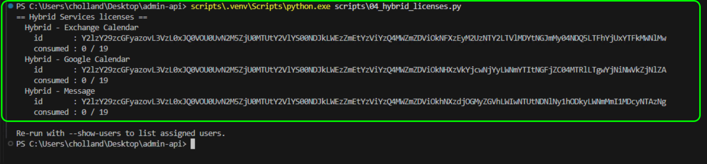
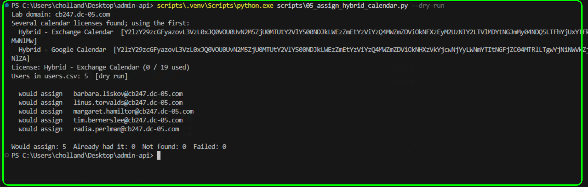
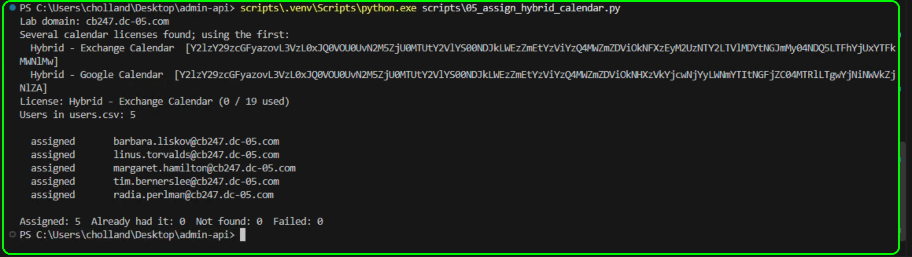
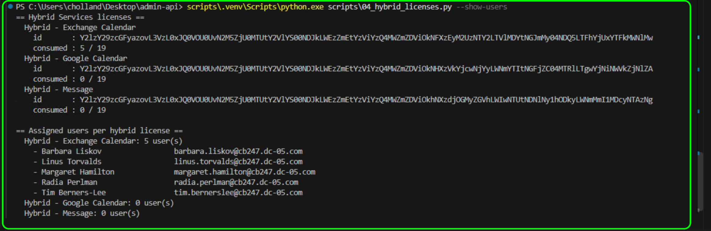
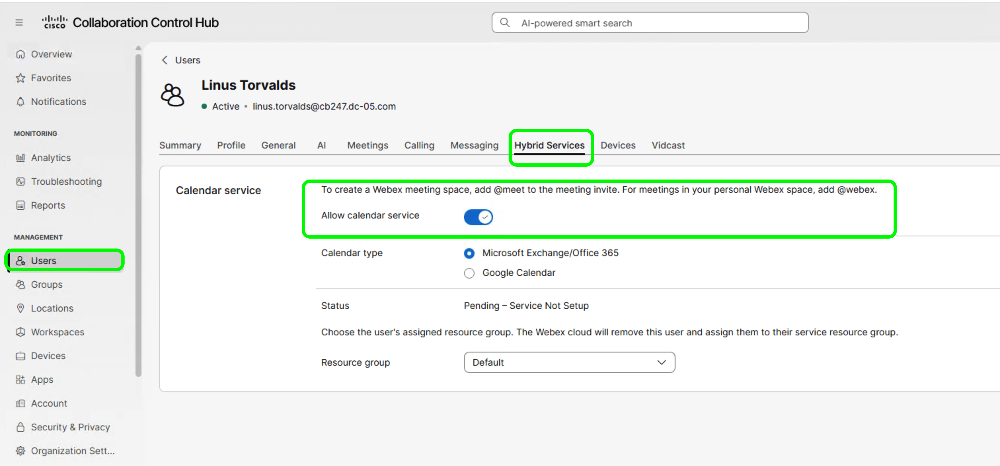

# Lab 4 - Hybrid Services licenses

**Time: 40-55 min**

Bruno returns every license. The script prints only the Hybrid Services licenses. Check Bruno first, then VS Code. Then assign the Hybrid Calendar license to the users in `data\users.csv` and see who holds it.

No Hybrid Services setup is needed. The Hybrid Calendar license is part of the organization's subscription, so you can assign it even when no Expressway connector is running.

## Section 1 - Find the Hybrid licenses

### What you are doing in this section

Hybrid Services are licenses, so you use the same `GET /v1/licenses` call as Lab 2. In Bruno you find the Hybrid rows yourself; the script filters them for you.

### Part A - Bruno

1. In the Bruno left sidebar, under **Webex Admin API Lab**, expand the **2. Licenses** folder and select **List licenses (usage)**.
2. Select **Send** at the right end of the URL bar.
3. In the response pane on the right, find the licenses whose `name` starts with **Hybrid**.

**Read the response**

A typical pod has **Hybrid - Exchange Calendar**, **Hybrid - Google Calendar**, and **Hybrid - Message**, each with `consumedUnits` `0`.

### Part B - VS Code

1. In the VS Code terminal, check that the prompt ends with `Desktop\admin-api>`.
2. Copy the command below, right-click in the terminal to paste it, and press `Enter`:

    ```bat
    scripts\.venv\Scripts\python.exe scripts\04_hybrid_licenses.py
    ```

    

**Read the output**

The same Hybrid licenses as Bruno, each with its `id` and `consumed` as used / total, such as `0 / 19`. The last line suggests `--show-users`; you run that in Section 3. `No Hybrid Services licenses found in this org.` is also a valid result.

## Section 2 - Assign the Hybrid Calendar license

### What you are doing in this section

You assign the Hybrid Calendar license to the five users from `data\users.csv` that you created in Lab 1 with `PATCH /v1/licenses/users`. You run it with `--dry-run` first to preview, then without it to assign. This is VS Code only.

### Run a dry run

1. In the VS Code terminal, copy the command below, right-click to paste it, and press `Enter`:

    ```bat
    scripts\.venv\Scripts\python.exe scripts\05_assign_hybrid_calendar.py --dry-run
    ```

    

2. Read the output. **License** is the calendar license it will use; if the pod has two, the script picks the first. Each user shows `would assign`, and the summary is `Would assign: 5`. Nothing has changed yet.

### Assign the license

1. Copy the command below, paste it in the terminal, and press `Enter`:

    ```bat
    scripts\.venv\Scripts\python.exe scripts\05_assign_hybrid_calendar.py
    ```

    

2. Read the output. Each user now shows `assigned`, and the summary is `Assigned: 5`. Running it again is safe; users show `already has it`.

## Section 3 - See who holds each Hybrid license

### What you are doing in this section

You check Section 2 by listing who holds each Hybrid license.

1. In the VS Code terminal, copy the command below, paste it, and press `Enter`:

    ```bat
    scripts\.venv\Scripts\python.exe scripts\04_hybrid_licenses.py --show-users
    ```

    

### Read the output

The calendar license you assigned now shows `consumed : 5 / 19` and `5 user(s)`, followed by the five CSV users. The other Hybrid licenses show `0 user(s)`. If the count is still `0`, wait a minute and run it again.

### Check the result in Control Hub

1. In Control Hub at [admin.webex.com](https://admin.webex.com){:target="_blank"}, under **Management**, select **Users**.
2. Search for one of the CSV users, such as `linus.torvalds`, and select the user to open their details.
3. Select the **Hybrid Services** tab. Under **Calendar service**, check that **Allow calendar service** is turned on.

    

    !!! note "Ignore Pending - Service Not Setup"
        **Status** shows **Pending - Service Not Setup** because Hybrid Calendar is not set up in this lab pod. This lab only assigns the license, so you can ignore this status.

## Checkpoint

You are ready for the conclusion when:

* [ ] You found the Hybrid rows in the Bruno license list, or confirmed there are none
* [ ] VS Code printed the same Hybrid licenses, or reported there are none
* [ ] The dry run showed `would assign` for the CSV users
* [ ] VS Code assigned the Hybrid Calendar license to the CSV users
* [ ] `--show-users` lists the CSV users under the Hybrid Calendar license
* [ ] Control Hub shows **Allow calendar service** turned on for a CSV user

## Troubleshooting

| Problem | Solution |
| --- | --- |
| VS Code prints nothing about Hybrid | Compare it with the Bruno list. If Bruno also has no Hybrid license, the organization does not have one. |
| `No Hybrid Calendar license found in this org` | The organization has no Hybrid Calendar license. Record it and continue. |
| `not found` for CSV users | Those users do not exist. Run the Lab 1 bulk create first, and check that the **Lab domain** the script prints is your verified domain. Cleanup runs only in the [Conclusion](conclusion.md). |
| `FAILED` with 403 on assign | The Service App needs `spark-admin:people_write` and `spark-admin:licenses_read`. Add the scope, authorize the app again, and generate a new access token. |
| CSV file not found | The VS Code terminal is not in `Desktop\admin-api`. |
| 401 | Use the current Service App access token in Bruno and in `.env`. |

Continue to the [Conclusion](conclusion.md).
