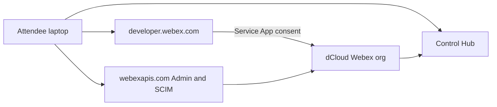

# Topologies

Each attendee works in an isolated dCloud Webex organization. The toolkit on the laptop calls public Admin and SCIM APIs with a pod-scoped token.

## Components

| Piece | Where it lives | Notes |
|---|---|---|
| Reservation | dCloud | Time-limited org + admin login + verified domain |
| Token | Local `.env` or Bruno secret | Service App preferred; never committed |
| Shared client | `scripts/webex_client.py` | Bearer, pagination, 429 retry |
| Bruno | `bruno/Webex Admin API Lab` | Same endpoints, collection-level Bearer |
| Tracking file | `data/created_users.json` | Cleanup allow-list |

## Trust boundary

- HTTPS only to `webexapis.com` / `developer.webex.com` / `admin.webex.com`.
- The Pages credential form never stores the access token.
- Cleanup cannot delete users that this lab did not create.
